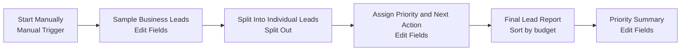

# Business Lead Manager (n8n)

A beginner-friendly n8n workflow that sorts business leads by priority and plans follow-ups. It uses only built-in n8n nodes and sample data: no API keys, credentials or outside services.

## Project overview
Business Lead Manager takes a list of sales enquiries and gives each one a priority (High, Medium or Low) based on simple budget rules. Each lead also gets a suggested next action, a follow-up status, a follow-up date and a plain-language reason for its priority. At the end, a summary counts the leads in each priority level.

## Business problem solved
Small businesses and freelancers often lose track of potential customers, forget follow-ups, and waste time deciding which enquiries to handle first. This workflow makes those decisions consistent and clear, so the most valuable leads are contacted first and no follow-up is forgotten.

## Features
- Six realistic sample leads (high, medium and low budget)
- Clear priority rules:
  - **High**: budget 1000 or more -> *Contact first*
  - **Medium**: budget 500-999 -> *Schedule a follow-up*
  - **Low**: budget below 500 -> *Nurture the lead*
- Follow-up status (Due now / Due soon / Scheduled later) and a follow-up date
- A plain-language explanation for each priority
- Leads sorted by budget, highest first
- A summary with counts per priority and the list of leads to contact first
- Runs entirely on built-in nodes, so it works on an n8n Cloud trial

> The budget numbers are example business rules, not currency recommendations.

## Workflow diagram


## Node-by-node explanation
| # | Node | Type | What it does (in plain words) |
|---|------|------|-------------------------------|
| 1 | Start Manually | Manual Trigger | The "start button". The workflow runs only when you click **Execute workflow**. |
| 2 | Sample Business Leads | Edit Fields (Set), JSON mode | Creates one item holding a list called `leads` with 6 sample enquiries. Each lead has `lead_id`, `customer_name`, `business_email`, `company_name`, `enquiry_type`, `estimated_budget`, `lead_status` and `follow_up_days`. |
| 3 | Split Into Individual Leads | Split Out | Breaks the list into 6 separate items, one per lead, so each lead can be handled on its own. |
| 4 | Assign Priority and Next Action | Edit Fields (Set) | Keeps every original field and adds `priority`, `suggested_action`, `follow_up_status` (1 day or less = Due now, 2-3 days = Due soon, more = Scheduled later), `follow_up_date` (today + follow_up_days) and `priority_explanation`. It uses simple if/else expressions on the budget. |
| 5 | Final Lead Report (Sorted by Budget) | Sort | Puts the leads in order of budget, highest first. This is the main report. |
| 6 | Priority Summary | Edit Fields (Set), runs once | Looks at all leads together and outputs one summary item: `total_leads`, `high_priority_count`, `medium_priority_count`, `low_priority_count` and `contact_first_leads`. |

## Example input (one lead)
```json
{
  "lead_id": "L-1001",
  "customer_name": "Priya Sharma",
  "business_email": "priya@brightpath-studio.test",
  "company_name": "BrightPath Studio",
  "enquiry_type": "Website Redesign",
  "estimated_budget": 2500,
  "lead_status": "New",
  "follow_up_days": 1
}
```

## Example output (one lead)
```json
{
  "lead_id": "L-1001",
  "customer_name": "Priya Sharma",
  "business_email": "priya@brightpath-studio.test",
  "company_name": "BrightPath Studio",
  "enquiry_type": "Website Redesign",
  "estimated_budget": 2500,
  "lead_status": "New",
  "follow_up_days": 1,
  "priority": "High",
  "suggested_action": "Contact first",
  "follow_up_status": "Due now",
  "follow_up_date": "2026-10-18",
  "priority_explanation": "Budget of 2500 is 1000 or more, so this is a High priority lead."
}
```

## Example summary output
```json
{
  "total_leads": 6,
  "high_priority_count": 2,
  "medium_priority_count": 2,
  "low_priority_count": 2,
  "contact_first_leads": "Priya Sharma (BrightPath Studio), Karan Patel (UrbanFit Gym)"
}
```
`follow_up_date` depends on the day you run the workflow.

## How to import and run in n8n
1. Download `business-lead-manager.json` from this repository (open the file, then click **Download raw file**).
2. In n8n, go to **Workflows -> Create workflow**, open the **...** menu (top right) and choose **Import from File**. You can also copy the JSON and paste it straight onto the canvas.
3. Click **Execute workflow**.
4. Open **Final Lead Report (Sorted by Budget)** to see every lead, and **Priority Summary** to see the counts.
5. To try your own leads, open **Sample Business Leads** and edit the JSON list.

## Limitations and future improvements
**Limitations**
- The leads are typed into the workflow. Nothing real comes in yet.
- Results are not saved between runs.
- Priority is based on budget only.

**Future improvements**
- Collect real enquiries with an n8n Form Trigger
- Store leads in n8n Data Tables or Google Sheets
- Send reminders when a follow-up is due (email, Slack, Telegram)
- Score leads on more than budget (enquiry type, status, response time)
- Run a daily follow-up digest on a Schedule Trigger

## No API keys or external services required
This workflow uses only built-in n8n nodes: Manual Trigger, Edit Fields (Set), Split Out and Sort. It needs no API keys, credentials, paid services, AI models or outside accounts. All email addresses use the reserved `.test` domain and are fictional.

## Repository structure
```
business-lead-manager/
├── business-lead-manager.json
├── README.md
└── .gitignore
```
